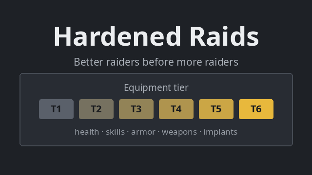

# Hardened Raids



A RimWorld 1.7 mod for **harder, more coherent raids** in the late game.

Vanilla scales raids by adding more and more poorly equipped raiders. Hardened Raids does the opposite: raiders first get **better** (healthier, more skilled, better armed and armored), and only then more numerous. Late-game raids become disciplined, uniformly equipped forces with sieges, support teams and, if you use Vehicle Framework, armored convoys.

## Features

- **No points cap**: the 10,000 points cap is removed and the wealth → points curves continue beyond 1M.
- **Equipment tiers**: T1 to T6 for industrial+ factions, N1 to N5 for tribal/medieval ones. Each tier raises health, skills, armor, weapons and implants.
- **Value-based pricing**: a raider costs its body plus the market value of everything it carries (quality, implants, cyberbrain). Quality depends on rank: 1 NCO per 10 raiders, 1 officer per 100. Masterwork and legendary gear stay rare.
- **Uniform loadouts**: one weapon set and one ammo type per raid, taken from the faction's own item tables. Melee sidearms replace Simple Sidearms' random junk.
- **Armor gate**: strong armor and armored mechanoids are capped by raid points, and spacer armor only shows up once your colony has researched spacer tech.
- **Waves**: up to 100 raiders per wave (industrial+) or 300 (neolithic/medieval); bigger raids arrive in several waves.
- **Smarter AI**: smart, breach and sapper raids become more common at high tiers, veterans avoid turret fields of fire, and turrets that are out of service (no power, empty magazine, no fuel) are ignored.
- **Reinforced sieges**: artillery and turrets from mods (Fortifications, VFE Security, CE Armory...), trenches facing your base, and forward support teams during assaults.
- **Enemy vehicles** (experimental, needs Vehicle Framework + Vanilla Vehicles Expanded): tanks, rocket and artillery fire support, trucks and IFVs, with crews, ammo and fuel. Vehicles are priced by value; rocket swarms and artillery cost much more.
- **Ammo sanity** (Combat Extended): no antigrain ammo, EMP and biological ammo made rare.
- **Language option**: English by default, French available (Mod settings → Hardened Raids).

Every feature can be tuned or disabled in the mod settings.

## Installation

**Requires [Harmony](https://steamcommunity.com/sharedfiles/filedetails/?id=2009463077).**

1. Download this repository (Code → Download ZIP) or the latest release.
2. Extract it into your `RimWorld/Mods/` folder.
3. Enable **Harmony**, then **Hardened Raids** below it (and below Combat Extended / Vehicle Framework if you use them).

The compiled mod (`Assemblies/HardenedRaids.dll`) is included, no build needed.

## Compatibility

- RimWorld **1.7** only.
- Optional, detected at runtime: Combat Extended (+ Armory), GiTS Cyberbrains, Simple Sidearms, Vehicle Framework / Vanilla Vehicles Expanded, Fortifications, VFE Security.
- Not compatible with *Unlimited Threat Scale* (both remove the points cap).
- Mods that replace raid pawn generation entirely may conflict.

## Building from source

Requires the .NET 10 SDK and, for the vehicle code, Vehicle Framework from the Steam Workshop.

```bash
cd Source/HardenedRaids
dotnet build -c Release
```

The DLL is written to `Assemblies/`. See [BUILD.md](BUILD.md) for the code structure.

## License

[MIT](LICENSE)

## Support

If you enjoy this mod, you can support its development:

[](https://www.paypal.com/donate/?hosted_button_id=P5SMYTGS8J52J)
