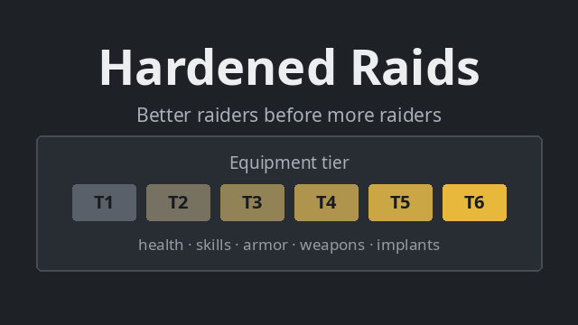

# Hardened Raids



A RimWorld 1.7 mod for **harder, more coherent raids** in the late game.

Vanilla scales raids by adding more and more poorly equipped raiders. Hardened Raids does the opposite: raiders first get **better** (healthier, more skilled, better armed and armored), and only then more numerous. Late-game raids become disciplined, uniformly equipped forces with sieges, support teams and, if you use Vehicle Framework, armored convoys.

## Features

- **No points cap**: the 10,000 points cap is removed and the wealth → points curves (per wealth, per colonist) continue beyond 1M.
- **Equipment tiers**: T1 to T6 for industrial+ factions, N1 to N5 for tribal/medieval ones. Each tier raises health, skills, armor, weapons and implants.
- **Value-based pricing**: a raider costs its body plus the market value of everything it carries (quality, implants, cyberbrain). Quality depends on rank: 1 NCO per 10 raiders, 1 officer per 100. Masterwork and legendary gear stay rare.
- **Uniform loadouts**: one weapon set per raid, taken from the faction's own item tables. Melee sidearms replace Simple Sidearms' random junk.
- **Armor gate**: strong armor and armored mechanoids are capped by raid points, and spacer armor only shows up once your colony has researched spacer tech.
- **Waves**: up to 100 raiders per wave (industrial+) or 300 (neolithic/medieval); bigger raids arrive in several waves, with the same gear, vehicles spread across waves, and quest links kept. Mechanoid raids and infestations are capped per wave too, and the cap stays even with equipment tiers disabled. Hostile groups outside raids come in a single group capped at the per-wave cap (twice that cap for bases you attack); the surplus is lost.
- **Everything uncapped, not only raids**: quest and site threats (bandit camps, relic hunts, ancient complexes, sleeping mechs…) keep vanilla values up to 10,000 points, then scale with the ratio vanilla has at 10,000, and hostile groups outside raids (crashed shuttle, caravan ambushes, sites, peace talks) get Hardened gear.
- **Faction bases you attack** (hostile, and also neutral or allied ones): defenders scale with your threat (25% by default, at most twice the per-wave cap), with modded perimeter turrets, mortars manned by Hardened defenders (at most 1 crew per 10 defenders, vanilla crews beyond) and, with Vehicle Framework, parked combat vehicles.
- **Mech clusters**: no 10,000 cap; big clusters are split into several clusters (some delayed) so the game never freezes (at most 10 per event, the surplus is lost); cluster turrets cost more.
- **Anomaly entities** (sightstealers, gorehulks, devourers, chimeras, fleshbeasts, noctols…): capped at the neolithic wave cap (300 by default); the extra entities walk in later in waves, or are discarded if you uncheck the option. Entity attacks get rarer when your threat exceeds what one wave can spend.
- **Duplicator obelisk** (Anomaly): duplicates scale with your threat but are capped at the per-wave cap (100 by default).
- **Manhunter packs**: up to the neolithic wave cap (300 by default); animal events get rarer when your threat exceeds what they can spend.
- **Smarter AI**: smart, breach and sapper raids become more common at high tiers, veterans avoid turret fields of fire, and turrets that are out of service (no power, empty magazine, no fuel) are ignored.
- **Reinforced sieges**: artillery and turrets from mods (Fortifications, VFE Security, CE Armory...; no anti-aircraft guns or spotlights), laid out as a real camp (artillery park at the back, turret arc in front, sandbag lines and parapets built once the guns are up) that holds under fire and keeps shelling you during its assault, and forward support teams during assaults.
- **Enemy vehicles** (experimental, needs Vehicle Framework + Vanilla Vehicles Expanded): tanks, rocket and artillery fire support, trucks and IFVs, with crews, ammo and fuel. Vehicles are priced by value; rocket swarms and artillery cost much more. At the end of a raid, vehicles that cannot leave (no driver, immobilized) are left behind as neutral wrecks: select one and press **Claim** (refused while an enemy is within 25 cells), then board, repair or deconstruct it with Vehicle Framework's own tools.
- **Motorized sieges** (Vehicle Framework): a siege that arrives with vehicles drives to its siege spot and sets up its camp like a siege on foot — passengers get off at the camp, trucks park behind it, tanks hold its flanks and give fire support until the siege assaults; passengers wounded or killed on board no longer make the siege stop to defend.
- **Ammo sanity** (Combat Extended): no antigrain ammo, EMP and biological ammo made rare.
- **Language option**: English by default, French available (Mod settings → Hardened Raids).

Every feature can be tuned or disabled in the mod settings.

## Installation

**Requires [Harmony](https://steamcommunity.com/sharedfiles/filedetails/?id=2009463077).**

1. Download this repository (Code → Download ZIP) or the latest release.
2. Extract it into your `RimWorld/Mods/` folder.
3. Enable **Harmony**, then **Hardened Raids** below it (and below Combat Extended / Vehicle Framework if you use them).

The compiled mod (`Assemblies/HardenedRaids.dll`) is included, no build needed.

## Uninstalling

Removing the mod does not break your save. Outside a raid you can simply remove it: the log will show harmless red errors (the game drops the mod's tier markers and pending waves by itself). During a raid, Hardened convoys and crews lose their group AI.

For a clean removal, open Mod settings → Hardened Raids → **Prepare to remove the mod** (in game): a raid in progress continues as a vanilla raid (infantry and turret crews assault, armed vehicles keep fighting under Vehicle Framework's AI, other vehicles leave, immobilized ones stay in place, captives aboard are dropped), pending waves are cancelled and the mod's markers are removed. Then save, quit, and remove the mod before loading that save.

## Compatibility

- RimWorld **1.7** only.
- Optional, detected at runtime: Combat Extended (+ Armory), GiTS Cyberbrains, Simple Sidearms, Vehicle Framework / Vanilla Vehicles Expanded, Fortifications, VFE Security.
- Vehicle Framework + Combat Extended: chain explosions fixed. Under CE's vehicle compatibility, a 0-damage hit (flame explosion, fire) still sets off a damaged vehicle's explosive parts, so a burning vehicle could re-explode endlessly. Now a vehicle has at most one explosion pending, and neither its own explosion nor fires from vehicle explosions set it off again (all vehicles, yours included; setting "Vehicles: no chain explosions", on by default).
- Vehicle Framework + Vanilla Vehicles Expanded: fireproof vehicles. VVE vehicles were flammable but never destroyed by fire, so a burning vehicle fed its own fire forever; with Combat Extended, fuel leaking from a damaged tank (woken up by a repair) lights itself and set the vehicle on fire. Fire no longer clings to vehicles; flamethrowers still deal their direct damage (all vehicles; setting "Vehicles: fireproof", on by default).
- Not compatible with *Unlimited Threat Scale* (both remove the points cap).
- Mods that replace raid pawn generation entirely may conflict.

## Building from source

Requires the .NET 10 SDK and, for the vehicle code, Vehicle Framework from the Steam Workshop.

```bash
cd Source/HardenedRaids
dotnet build -c Release
```

The DLL is written to `Assemblies/`. See [BUILD.md](BUILD.md) for the code structure.

## License

[MIT](LICENSE)

## Support

If you enjoy this mod, you can support its development:

[](https://www.paypal.com/donate/?hosted_button_id=P5SMYTGS8J52J)
